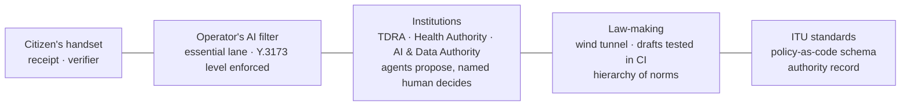
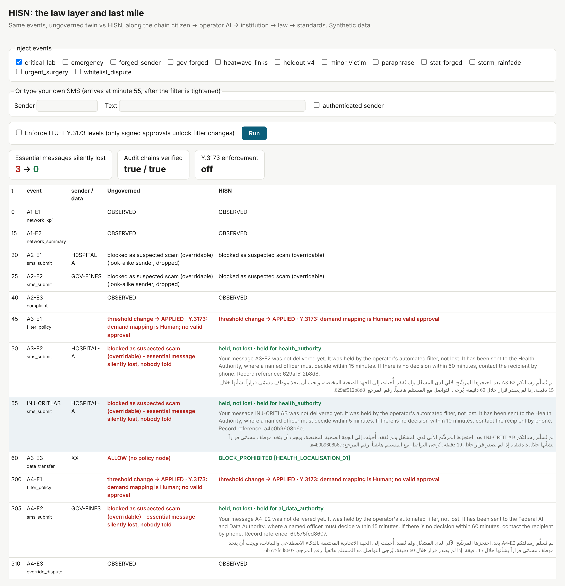
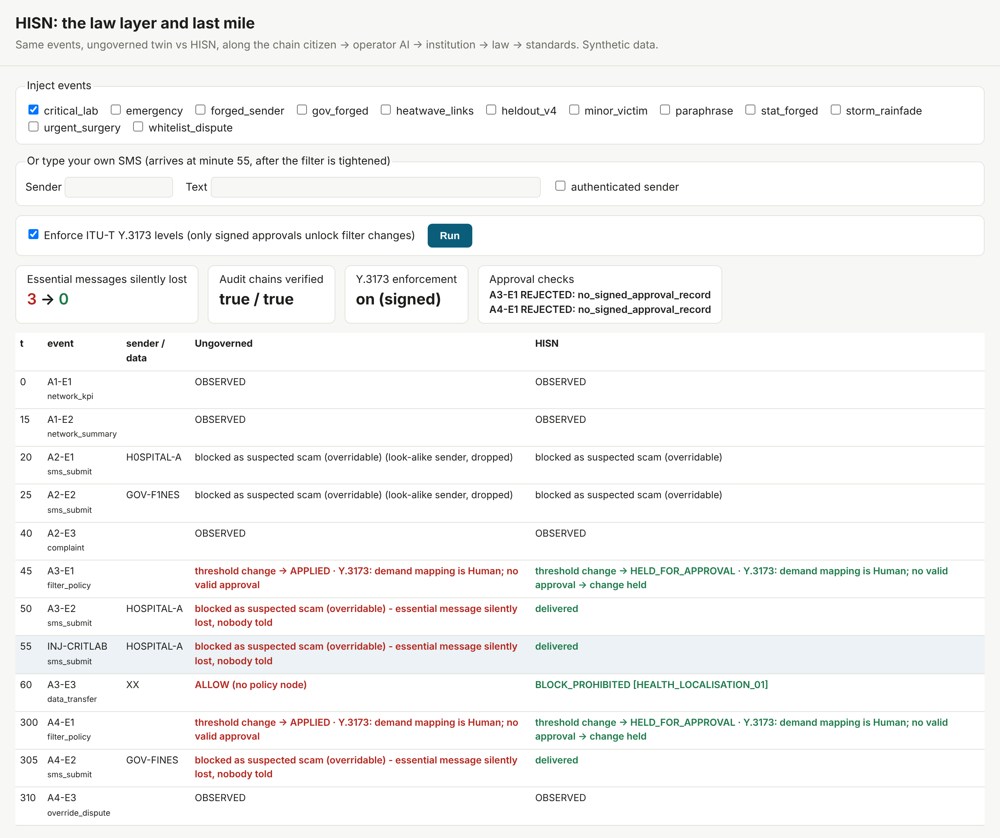

# HISN — the law layer and last mile for agentic government

**No essential message lost in silence. No rule issued untested.**

Team Sankalp · ITU AI for Good Lab Hackathon (UAE) · Telecommunications + Healthcare + Public services
Eswar Panchakarla (team leader, engineering) · P. Prudhvi Krishna (knowledge base, policy, report) · eswarpnbs@gmail.com
**Technical report:** [`docs/HISN_Submission_Team_Sankalp.pdf`](docs/HISN_Submission_Team_Sankalp.pdf) · **Live report:** https://hisn-report.netlify.app/ · Synthetic data only; fictional senders.

The UAE plans to deliver half of its government services through AI agents. Security testing asks *is the agent safe?* Monitoring asks *what did it do?* HISN answers the two questions left over:

1. **Is this action lawful, and under which clause?**
2. **Did the citizen actually receive the outcome?**

Decisions reach people as text messages, and those messages pass through AI gatekeepers such as an operator's SMS filter. HISN governs that last mile and tests the rules before they bind. It is designed to complement national testing and monitoring, not replace them.



## What HISN does

| Capability | What you can run |
|---|---|
| **The right to be reached**: essential senders are never silently dropped; a held message goes to a named officer within a clinical limit; the sender gets an accountable receipt over real SMPP 3.4 | `python run_smpp.py`, then `python smpp_demo.py` |
| **Both harms measured**: essential messages lost *and* scams delivered, as one MIZAN balance | `python run_gap_engine.py` |
| **Crash-test the rule**: a draft is tested against verified law, the hierarchy of norms and nine public-interest invariants, and the wind tunnel says which instrument can carry it | `python wind_tunnel.py "<draft>" --level regulation` |
| **Law as a pull request**: draft rules run through CI; a draft that fails is refused automatically | `drafts/`, `.github/workflows/wind-tunnel.yml` |
| **Declared autonomy, enforced**: each component's ITU-T Y.3173 level is computed by the standard's method; a filter change that breaks it is held | `python run_demo.py --enforce-levels` |
| **Approval that can't be faked**: a filter change needs a signed record, bound to that change, from a competent role, within its validity window, and from someone other than the requester (maker and checker). A typed name, an edited, copied or expired record, or a self-approval is held | `python run_approval_demo.py` |
| **Live chain console**: inject events or type an SMS and watch each one move citizen → operator AI → institution → law → standards, ungoverned vs HISN, with receipts in English and Arabic | `python console.py`, then open http://127.0.0.1:8765 |
| **Arabic, the authoritative text**: Arabic receipts; key UAE articles stored from the official Arabic PDFs and re-verified (`kb/arabic.py`); Arabic templates pending native review | `python kb/arabic.py verify` |
| **Gaps found by the system**: when no provision covers an event, the agents log a gap (G5 and G7 were found this way) | `python run_agents.py --model qwen2.5:14b` |
| **Portability, measured**: the same engine runs on UAE, India and Singapore packs | `python run_interop.py` |

Standard safeguards underneath: a policy node that blocks only on a verified binding clause; agents that cite retrieved evidence and only propose (five fixed gates); named sign-off; a hash-chained audit log; every agent decision logged with its assessment, evidence, citations and uncertainty.

## Results (every figure re-derived by `python selftest.py`; see docs/headline_numbers.md)

| Measure | Result |
|---|---|
| Legitimate essential messages silently lost (twin run) | ungoverned **10 → 0** with HISN |
| Offshore health-data transfers not blocked | **2 → 0** |
| Harmful decisions on 33 gold items (qwen2.5:14b) | LLM alone 10 · fixed rules 10 · RAG without gates 9 · **HISN 1** |
| Unsupported legal citations | LLM alone 41 · **HISN 0** |
| Pre-registered held-out sets (gold committed before scoring, checked from git history) | 17/23 (about 54–87%) |
| Agent decisions identical across repeated runs | 44/44 |
| Sender authentication + verified lane (gap engine) | MIZAN 76.7 → **94.2**; a blunt fraud duty alone lowers it |
| UAE–India decision agreement | 56% |
| Knowledge base | 16 hash-pinned official records, 38 verbatim clauses, ITU reference ingest pipeline |
| Tests | 94 passing |

Accuracy intervals overlap, so we claim a difference in harm and citation support, not in accuracy. Known failure, disclosed: on held-out v4 one spoofed message was recommended for release; a named human must still act on any release.

## Policy and standards gaps (docs/gap_register.yaml)

G1 fraud and impersonation outside filtering duties · G2 no protected status for government and health senders · G3 no explicit legal basis for AI scanning of health SMS · G4 no emergency path for systematic AI-triggered failover · G5 no authority over operators' AI filter changes (found by the agents) · G6 no allocation of scam losses to operators · G7 essential-sender recognition does not cross borders (measured).
Standards: a machine-readable policy-rule format (our YAML schema, offered to ITU); an authority record joining the declared Y.3173 level, the named approval and the cited clause; and a Readiness Framework gap: none of the 111 metrics in ITU's dimensions.json measures whether an agent's consequential action had verified authority (agents appear only as d11_m03, a user-interface metric).

## See it





## Quick start
```bash
bash setup.sh                    # venv, ITU reference repo, models, knowledge base, tests
python run_demo.py               # governed vs ungoverned twin, same events
python console.py                # live chain console in the browser: http://127.0.0.1:8765
python run_demo.py --enforce-levels   # Y.3173 levels enforced: unapproved filter changes held
python run_approval_demo.py      # maker-checker: which approvals can unlock a filter change
python inject_console.py         # terminal judge console: add events or type a custom SMS
python run_agents.py --model qwen2.5:14b   # institutional agents + pre-registered evaluation
python run_gap_engine.py         # loopholes, counterfactual provisions, load-bearing rules
python run_baselines.py --model qwen2.5:14b  # rules vs LLM-only vs RAG-no-gate vs full HISN
python run_interop.py            # UAE vs India rule packs: agreement, divergences, gap coverage
python verify_message.py --sender H0SPITAL-A --text "Pay at http://x.example" --lang hi   # citizen verifier (6 languages)
python run_smpp.py               # real SMPP 3.4 server (then: python smpp_demo.py in another tab)
python build_dataset.py          # synthetic SMS dataset in ITU catalogue format
python export_itu_game.py        # export to ITU AI Readiness Simulation Game formats
python wind_tunnel.py "During a declared emergency, health message logs may be stored at a backup site abroad for 72 hours." --level regulation   # regulatory impact card
python selftest.py               # re-derives every headline number -> docs/headline_numbers.md
python build_dashboard.py && open docs/dashboard.html   # offline single-file dashboard
```

## Repository map
| path | contents |
|---|---|
| `app/core/` | enums, hash-chained audit log, policy gateway (P node), event bus, coordinator (MLFO), SMS firewall |
| `app/agents/` | institutional agents, retriever over the ITU KB, LLM wrapper, baselines |
| `app/gapengine/` | tactic catalogue, candidate provisions, engine, sign-off |
| `kb/` | manifest (SHA-256), verbatim clauses, rule packs, ingest via ITU pipeline, verify, retrieval eval |
| `scenarios/` | Crisis Exploit (Acts 1–4), injects, pre-registered gold (dev, held-out), ground truth (dashboard only) |
| `docs/` | evaluation logs, baselines, retrieval eval, counterfactual results, gap register, dashboard |
| `app/windtunnel/` | regulatory wind tunnel: draft rule -> mechanism mapping -> conflict scan -> regression tests -> Regulatory Impact Card |
| `app/smpp/` | SMPP 3.4 server for the SMS firewall demo |
| `drafts/` | example draft rules used by the wind tunnel |
| `open_kb/` | open knowledge-base package (checksums, datasheet, gap register copy, agent cards) |
| `tools/` | verification, fairness, stability and report-building scripts (`verify_all.py`, `fairness_check.py`, ...) |

## Knowledge base and copyright
Source PDFs are **not redistributed**. `kb/manifest.csv` lists each official URL and SHA-256; download into `kb/sources/` and run `python kb/verify.py`. Only short verbatim clauses are stored, with article references. English versions of UAE laws are translations; the Arabic text is authoritative.

## Limitations (honest)
Synthetic battery and scoring weights: results show direction, not real-world magnitudes. Global examples in docs/global_examples.yaml were checked against official sources (30 Oct - 1 Nov 2026); Regulation (EU) 2026/1881 is confirmed on EUR-Lex (7 Nov 2026); the Australian scam-SMS code is cited through an ACMA investigation report, which is flagged for replacement by the code's own text. Approval signatures use demo keys, not a production identity service. Arabic receipt and verifier wording is pending native review. Comparators on the gap engine's candidate provisions are marked "verify text" or "verification: pending" and are illustrative only. The 0.25 retrieval threshold does not transfer across embedding models and is not claimed as a safeguard. The SMS firewall accepts SMPP `submit_sm`-shaped messages; it is not a production SMSC.

## Verify our claims yourself

```bash
python tools/verify_all.py
```

Checks, without trusting us: every source file against its pinned SHA-256; every verbatim clause against its source PDF (normalisation rules printed); every audit-log hash chain; that each held-out gold file was committed before its first scored result (git history); and the open knowledge-base checksums.

## Key documents

| Document | What it shows |
|---|---|
| [`docs/gap_register.yaml`](docs/gap_register.yaml), [`docs/global_examples.yaml`](docs/global_examples.yaml) | Domain-level policy gaps with verbatim evidence, and verified global examples (Australia, EU) |
| [`docs/y3172_mapping.md`](docs/y3172_mapping.md), [`docs/readiness_mapping.md`](docs/readiness_mapping.md) | All 9 Y.3172 nodes; Readiness 2.0 metrics (ITU-verified IDs and metrics named in the report text) |
| [`docs/automation_levels.md`](docs/automation_levels.md) | ITU-T Y.3173 levels per component, computed by the standard's method |
| [`docs/what_if_none.md`](docs/what_if_none.md), [`docs/what_if_adopted.md`](docs/what_if_adopted.md) | Simulated timeline per filter threshold vs targets (Report 2.0, Dimension 10) |
| [`docs/case_brief_filter_threshold.md`](docs/case_brief_filter_threshold.md) | Governance case brief: the filter-threshold lesson |
| [`docs/cross_border.md`](docs/cross_border.md) | Gap G7: essential-sender recognition does not cross borders (India to UAE, measured) |
| [`docs/daily_report_none.md`](docs/daily_report_none.md), [`docs/fairness_check.md`](docs/fairness_check.md) | Regulator's daily assurance page; cross-language fairness check |
| [`docs/agent_cards/`](docs/agent_cards/), [`docs/datasheet_sms_dataset.md`](docs/datasheet_sms_dataset.md) | Agent cards (ITU-T Y.3176 fields); dataset datasheet |
| [`open_kb/`](open_kb/) | Open knowledge-base contribution for the ITU AI for Good Lab (acknowledgement to the UAE) |
| [`docs/onboarding_guide.md`](docs/onboarding_guide.md) | How to add a country or a domain |

## Principles

- **Domain-level gaps, not national recommendations.** HISN identifies domain-level policy gaps. National instruments (UAE, India, Singapore) are used as evidence, and verified global examples (e.g. Australia, EU) show how others have addressed each gap. Draft rules tested in the wind tunnel are illustrative and demonstrate the method; HISN makes no country-specific recommendations.
- **AI validates impact; humans decide** (ITU AI Readiness Report 2.0, FAQ 7). Language models only propose; deterministic code checks evidence and legal basis; a named human confirms every mechanism mapping and signs off every decision. The policy and legal adviser cites law but never makes it.

## Licence
Apache-2.0 (code). Knowledge-base metadata and clauses are provided for research; source documents remain the property of their issuers.
Synthetic SMS dataset (generated by `build_dataset.py`): CC-BY-4.0.

**Reproducing the exact headline numbers:** source documents are not redistributed. Download them from the URLs in `kb/manifest.csv` into `kb/sources/` and run `python kb/verify.py` to check their SHA-256 hashes. Without them, `setup.sh` still builds a working knowledge base from the 38 verbatim clauses, all tests pass, and agent results may differ slightly.
