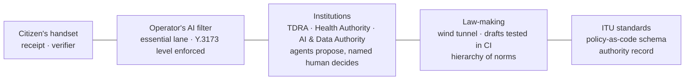

# HISN — the law layer and last mile for agentic government

[](https://github.com/Eswarpnbs/HISN/actions/workflows/tests.yml)

**No essential message lost in silence. No rule issued untested.**

Team Sankalp · ITU AI for Good Lab Hackathon (UAE) · Telecommunications + Healthcare + Public services
P. Prudhvi Krishna (team leader; knowledge base, policy, report) · Eswar Panchakarla (engineering) · krishna.prudhvi.01@gmail.com · eswarpnbs@gmail.com
**Technical report:** [`docs/HISN_Submission_Team_Sankalp.pdf`](docs/HISN_Submission_Team_Sankalp.pdf) · **Live report:** https://hisn-report.netlify.app/ · Scenario messages are synthetic (fictional senders); four evaluations use real public data.

The UAE plans to deliver half of its government services through AI agents. Security testing asks *is the agent safe?* Monitoring asks *what did it do?* HISN answers the two questions left over:

1. **Is this action lawful, and under which clause?**
2. **Did the citizen actually receive the outcome?**

Decisions reach people as text messages, and those messages pass through AI gatekeepers such as an operator's SMS filter. HISN governs that last mile and tests the rules before they bind. It is designed to complement national testing and monitoring, not replace them.



## What HISN does

| Capability | What you can run |
|---|---|
| **The right to be reached**: essential senders are never silently dropped; a held message goes to a named officer within a clinical limit; the sender gets an accountable receipt over real SMPP 3.4 | `python run_smpp.py`, then `python smpp_demo.py` |
| **Both harms measured**: essential messages lost *and* scams delivered, as one MIZAN balance (ميزان, Arabic for "balance": the average of protection, the share of scam attempts not delivered, and access, the share of legitimate messages delivered, on a fixed set of 84 test messages, 60 scam attempts and 24 legitimate; baseline (86.7 + 66.7) / 2 = 76.7) | `python run_gap_engine.py` |
| **Crash-test the rule**: a draft is tested against verified law, the hierarchy of norms and nine public-interest invariants, and the wind tunnel says which instrument can carry it | `python wind_tunnel.py "<draft>" --level regulation` |
| **Law as a pull request**: draft rules run through CI; a draft that fails is refused automatically | `drafts/`, `.github/workflows/wind-tunnel.yml` |
| **Declared autonomy, enforced**: each component's ITU-T Y.3173 level is computed by the standard's method; a filter change that breaks it is held | `python run_demo.py --enforce-levels` |
| **Approval that can't be faked**: a filter change needs an Ed25519-signed record (the checker holds only public keys), bound to that change, from a competent role, within its validity window, and from someone other than the requester (maker and checker). A typed name, an edited, copied or expired record, or a self-approval is held | `python run_approval_demo.py` |
| **Live chain console**: inject events or type an SMS and watch each one move citizen → operator AI → institution → law → standards, ungoverned vs HISN, with receipts in English and Arabic | `python console.py`, then open http://127.0.0.1:8765 |
| **Arabic, the authoritative text**: 29 official Arabic legal texts read by OCR (the PDFs' text layer is broken); an automatic check finds all 1,443 English article numbers in them; Arabic SMS checks and receipts; native review pending | `python tools/arabic_ocr_quality.py` |
| **Checked by someone else's software**: an independent SMPP client (smpplib) binds, submits and receives receipts; it found one protocol error, now fixed | `python tools/smpp_interop_check.py` |
| **Gaps found by the system**: when no provision covers an event, the agents log a gap (G5 and G7 were found this way) | `python run_agents.py --model qwen2.5:14b` |
| **Portability, measured**: the same engine runs on UAE, India and Singapore packs | `python run_interop.py` |

Standard safeguards underneath: a policy node that blocks only on a verified binding clause; agents that cite retrieved evidence and only propose (six fixed gates; the sixth: a release needs an authenticated sender); fixed message checks given to the model as facts; majority vote of 3; named sign-off; a hash-chained audit log; every agent decision logged with its assessment, evidence, citations and uncertainty.

## Results (re-derived by `python selftest.py` and `python tools/verify_all.py`; see docs/headline_numbers.md)

"Fixed" = the gold answers (or counting rules) were committed in git before the first scored run; `tools/verify_all.py` checks this from git history.

| Test | Data | Result | Fixed |
|---|---|---|---|
| **Agents on real texts** | All 275 real SMS the filter holds (Mishra and Soni 2022, CC BY 4.0; no sampling) | **251/275 (87–94%)**; real scams released **0 of 157** (gate 6 stopped 4); 20 of 118 legitimate held for a named officer | Yes |
| Agents, held-out v7 + v8 | 18 new messages, 6 in Arabic; v8 with majority vote of 3 | **8/8 and 10/10, 0 harmful** (18/18, 82–100%) | Yes |
| Agents, earlier held-out first runs | v2–v6, paraphrase | v2 4/4 · v3 1/2 · v4 6/9 (1 harmful) · paraphrase 6/8 · v5 4/8 · v6 5/8 (1 harmful); each harmful case led to a fixed rule tested on a new set | Yes |
| Baselines, 33 gold items | Synthetic | Harmful: LLM alone 10 · fixed rules 10 · RAG without gates 9 · **HISN 1**; unsupported citations: LLM alone 41 · **HISN 0** | Yes |
| Twin run | Governed vs ungoverned | Essential messages silently lost **10 → 0**; offshore health-data transfers allowed **2 → 0** | — |
| Message checks, real SMS | 5,971 real SMS | Risk signal on **79%** of real smishing, **0.1%** of real legitimate | Yes |
| Arabic checks, real messages | 13,240 real Arabic messages (Zayed University) | 0.8% of legitimate flagged; none flagged as asking for a secret | Yes |
| Filter drift, real SMS | 5,574 real SMS (UCI) | Threshold 0.5 → 0.2: legitimate blocked **0 → 103**, spam caught 88 | — |
| Retrieval on official wording | 13 descriptions of UAE laws published on u.ae | Right law in top 5: **12/13**; top 1: 3/13 | Yes |
| Arabic OCR structure | 29 Arabic legal texts | All **1,443** article numbers of the English texts found | — |
| SMPP interoperability | Independent client (smpplib) | 5/5 cases as expected; one protocol error found and fixed | — |
| Sender authentication + verified lane | Gap engine | MIZAN 76.7 → **94.2** | — |
| Portability | UAE vs India packs | 56% decision agreement; foreign essential sender arrives like a spoof (G7) | — |
| Stability / tests | Repeated runs; test suite | 44/44 identical; **132 tests** passing | — |

Baseline accuracy intervals overlap, so we claim a difference in harm and citation support, not accuracy. Sets v2–v8 are small and v7–v8 were written by the team on the day of the rule they test; the 275-text real set (real texts, simulated sender authentication) answers both points.

## Policy and standards gaps (docs/gap_register.yaml)

G1 fraud and impersonation outside filtering duties · G2 no protected status for government and health senders · G3 no explicit legal basis for AI scanning of health SMS · G4 no emergency path for systematic AI-triggered failover · G5 no authority over operators' AI filter changes (found by the agents) · G6 no allocation of scam losses to operators · G7 essential-sender recognition does not cross borders (measured).
Standards: a machine-readable policy-rule format (our YAML schema, offered to ITU); an authority record joining the declared Y.3173 level, the named approval and the cited clause; and a Readiness Framework gap: none of the 111 metrics in ITU's dimensions.json measures whether an agent's consequential action had verified authority (agents appear only as d11_m03, a user-interface metric).

**Contributed to ITU's reference repository:** [#1 Arabic legal PDFs ingest as broken text; OCR fallback recovers them](https://github.com/CrashingGuru/ITUAIReadiness/issues/1) · [#2 a Readiness Framework metric for agent authority](https://github.com/CrashingGuru/ITUAIReadiness/issues/2) · [#3 a machine-readable policy-rule format bound to verified legal text](https://github.com/CrashingGuru/ITUAIReadiness/issues/3).

## See it


## Quick start
```bash
bash setup.sh                    # venv, ITU reference repo, models, knowledge base, tests
python run_demo.py               # governed vs ungoverned twin, same events
python console.py                # live chain console in the browser: http://127.0.0.1:8765
python run_demo.py --enforce-levels   # Y.3173 levels enforced: unapproved filter changes held
python run_approval_demo.py      # maker-checker: which approvals can unlock a filter change
python inject_console.py         # terminal judge console: add events or type a custom SMS
python run_agents.py --model qwen2.5:14b   # institutional agents + pre-registered evaluation
python run_gap_engine.py         # loopholes, counterfactual provisions, load-bearing rules
python run_baselines.py --model qwen2.5:14b  # rules vs LLM-only vs RAG-no-gate vs full HISN
python run_interop.py            # UAE vs India rule packs: agreement, divergences, gap coverage
python verify_message.py --sender H0SPITAL-A --text "Pay at http://x.example" --lang hi   # citizen verifier (6 languages)
python run_smpp.py               # real SMPP 3.4 server (then: python smpp_demo.py in another tab)
python build_dataset.py          # synthetic SMS dataset in ITU catalogue format
python export_itu_game.py        # export to ITU AI Readiness Simulation Game formats
python wind_tunnel.py "During a declared emergency, health message logs may be stored at a backup site abroad for 72 hours." --level regulation   # regulatory impact card
python selftest.py               # re-derives every headline number -> docs/headline_numbers.md
python build_dashboard.py && open docs/dashboard.html   # offline single-file dashboard
```

## Repository map
| path | contents |
|---|---|
| `app/core/` | enums, hash-chained audit log, policy gateway (P node), event bus, coordinator (MLFO), SMS firewall |
| `app/agents/` | institutional agents, retriever over the ITU KB, LLM wrapper, baselines |
| `app/gapengine/` | tactic catalogue, candidate provisions, engine, sign-off |
| `kb/` | manifest (SHA-256), verbatim clauses, rule packs, ingest via ITU pipeline, verify, retrieval eval |
| `scenarios/` | Crisis Exploit (Acts 1–4), injects, pre-registered gold (dev, held-out), ground truth (dashboard only) |
| `docs/` | evaluation logs, baselines, retrieval eval, counterfactual results, gap register, dashboard |
| `app/windtunnel/` | regulatory wind tunnel: draft rule -> mechanism mapping -> conflict scan -> regression tests -> Regulatory Impact Card |
| `app/smpp/` | SMPP 3.4 server for the SMS firewall demo |
| `drafts/` | example draft rules used by the wind tunnel |
| `open_kb/` | open knowledge-base package (checksums, datasheet, gap register copy, agent cards) |
| `tools/` | verification, fairness, stability and report-building scripts (`verify_all.py`, `fairness_check.py`, ...) |

## Knowledge base and copyright
84 official records, each SHA-256 pinned in `kb/manifest.csv` and identified from its own first page: 35 UAE instruments in English, 29 in authoritative Arabic, 10 ITU-T Recommendations (Y.3172–Y.3174, X.1231–X.1247 anti-spam series) and 10 comparator instruments (India, Singapore, Saudi Arabia, Australia, EU).

**Included in this repository (`kb/sources/`, 61 PDFs):** UAE federal laws, decree-laws and Cabinet resolutions in English and Arabic, copied unchanged from uaelegislation.gov.ae. Official documents such as laws and regulations are not protected by copyright in the UAE (Federal Decree-Law No. 38 of 2021 on Copyrights, Art. 3). Also included: the EU regulation (reuse permitted by EUR-Lex) and two Indian Acts. The Arabic OCR texts (`kb/sources/ocr/`) are an unreviewed machine reading of the official Arabic PDFs.
**Not included (linked only):** ITU-T Recommendations (all rights reserved by ITU), industry codes, regulator guidelines and policy papers. Download them from the URLs in `kb/manifest.csv` into `kb/sources/`; `python kb/verify.py` checks their hashes. English versions of UAE laws are translations; the Arabic text is authoritative.

## Limitations (honest)
Synthetic battery and scoring weights: results show direction, not real-world magnitudes. Global examples in docs/global_examples.yaml were checked against official sources (30 Oct - 1 Nov 2026); Regulation (EU) 2026/1881 is confirmed on EUR-Lex (7 Nov 2026); the Australian scam-SMS code is cited through an ACMA investigation report, which is flagged for replacement by the code's own text. Approvals are Ed25519-signed but use demo keys, not keys issued by an identity service. The 29 Arabic legal texts are OCR, unreviewed for wording; Arabic message checks, receipts and verifier wording are pending native review; the Arabic evaluation data is tweets, not SMS. In the 275-text real set, sender IDs and authentication are simulated (no public data has them). Comparators on the gap engine's candidate provisions are marked "verify text" or "verification: pending" and are illustrative only. The 0.25 retrieval threshold does not transfer across embedding models and is not claimed as a safeguard. The SMS firewall accepts SMPP `submit_sm`-shaped messages; it is not a production SMSC.

## Verify our claims yourself

```bash
python tools/verify_all.py
```

Checks, without trusting us: every source file present against its pinned SHA-256 (sources not in the repository are reported as SKIP, with where to get them); every verbatim clause against its source PDF (normalisation rules printed); every audit-log hash chain; that each held-out gold file was committed before its first scored result (git history); and the open knowledge-base checksums.

## Key documents

| Document | What it shows |
|---|---|
| [`docs/gap_register.yaml`](docs/gap_register.yaml), [`docs/global_examples.yaml`](docs/global_examples.yaml) | Domain-level policy gaps with verbatim evidence, and verified global examples (Australia, EU) |
| [`docs/y3172_mapping.md`](docs/y3172_mapping.md), [`docs/readiness_mapping.md`](docs/readiness_mapping.md) | All 9 Y.3172 nodes; Readiness 2.0 metrics (ITU-verified IDs and metrics named in the report text) |
| [`docs/automation_levels.md`](docs/automation_levels.md) | ITU-T Y.3173 levels per component, computed by the standard's method |
| [`docs/what_if_none.md`](docs/what_if_none.md), [`docs/what_if_adopted.md`](docs/what_if_adopted.md) | Simulated timeline per filter threshold vs targets (Report 2.0, Dimension 10) |
| [`docs/case_brief_filter_threshold.md`](docs/case_brief_filter_threshold.md) | Governance case brief: the filter-threshold lesson |
| [`docs/cross_border.md`](docs/cross_border.md) | Gap G7: essential-sender recognition does not cross borders (India to UAE, measured) |
| [`docs/daily_report_none.md`](docs/daily_report_none.md), [`docs/fairness_check.md`](docs/fairness_check.md) | Regulator's daily assurance page; cross-language fairness check |
| [`docs/agent_cards/`](docs/agent_cards/), [`docs/datasheet_sms_dataset.md`](docs/datasheet_sms_dataset.md) | Agent cards (ITU-T Y.3176 fields); dataset datasheet |
| [`open_kb/`](open_kb/) | Open knowledge-base contribution for the ITU AI for Good Lab (acknowledgement to the UAE) |
| [`docs/onboarding_guide.md`](docs/onboarding_guide.md) | How to add a country or a domain |

## Principles

- **Domain-level gaps, not national recommendations.** HISN identifies domain-level policy gaps. National instruments (UAE, India, Singapore) are used as evidence, and verified global examples (e.g. Australia, EU) show how others have addressed each gap. Draft rules tested in the wind tunnel are illustrative and demonstrate the method; HISN makes no country-specific recommendations.
- **AI validates impact; humans decide** (ITU AI Readiness Report 2.0, FAQ 7). Language models only propose; deterministic code checks evidence and legal basis; a named human confirms every mechanism mapping and signs off every decision. The policy and legal adviser cites law but never makes it.

## Licence
Apache-2.0 (code). Knowledge-base metadata and clauses are provided for research; source documents remain the property of their issuers.
Synthetic SMS dataset (generated by `build_dataset.py`): CC-BY-4.0.

**Reproducing the exact headline numbers:** a fresh clone already holds 61 of the 84 sources. Add the linked ones (ITU-T Recommendations and policy papers) from the URLs in `kb/manifest.csv` into `kb/sources/` and re-run `bash setup.sh`. Without them, all tests and checks pass and the agents run on the included laws; agent results may differ slightly.
